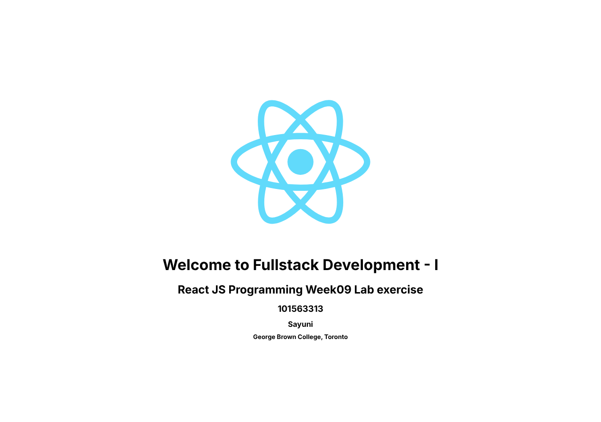

# COMP 3123 – Full Stack Development I – Lab Week 09 (React JS)

**Student:** Sayuni – 101563313
**College:** George Brown College, Toronto

The default Create React App page was changed to show the course title, the lab title, my student ID, my name and the college.

- `src/App.js` keeps the information in a **state** object (`useState`).
- `src/StudentInfo.js` gets the values as **props** and shows them as `h1`–`h5` headings.

## Run

```bash
npm install
npm start
```

Then open http://localhost:3000.


